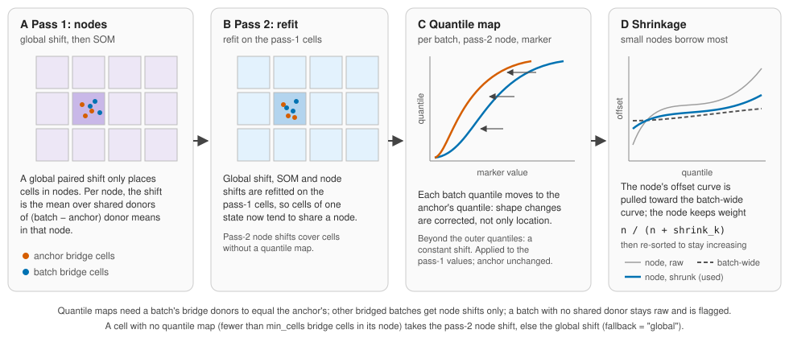

# bridgenorm

Batch correction for cytometry from bridge samples: reference material from the same donor measured in every batch.

Site and articles: <https://mdmanurung.github.io/bridgenorm/>

The differences between bridge samples measure the technical batch effect. bridgenorm estimates the batch effect from them alone, so study samples never enter a fit and their biology cannot be removed as batch effect. Each batch is corrected toward one anchor batch. A fitted model is frozen with a digest, so it applies to new data without changing earlier corrections.


## Methods

`bn_fit()` is the main method. It works on reference cells only, in two passes:

1. A global paired shift places the bridge cells, and a self-organising map (SOM) on the mapping markers splits them into nodes (cell states). Each batch gets a paired shift per node: the mean over shared bridge donors of the batch-minus-anchor donor means.
2. The global shift, map and node shifts are refitted on the pass-1 cells. In each (batch, node), the batch's marker quantiles are mapped onto the anchor's; cells without a map take the pass-2 node shift. This corrects changes in the shape of a distribution, not only its location. Every node's offset curve is shrunk toward the batch-wide curve, keeping weight n / (n + `shrink_k`), so small nodes borrow most.



Only batches whose bridge donors equal the anchor's get quantile maps; other bridged batches get node shifts only. A batch that shares no bridge donor with the anchor is left raw and flagged.

Two options are off by default. Estimates at the defaults are unchanged from 0.9.0.

- `target = "virtual"` corrects every batch, the anchor included, toward a virtual reference. Per SOM node, the reference is the equal-weight mean of the batches' quantile curves. Its benefit over the anchor target was not consistent across benchmarks, so the default stays `target = "anchor"`. It does not combine with `shrink_k = "eb"`.
- `shrink_k = "eb"` estimates one pseudo-count per marker by empirical Bayes, never below 300. It is kept for study; in benchmarks it did not beat the scalar default.

`bn_fit_paired()` fits the baseline: one paired shift per population and marker, with no nodes and no quantile maps. Every other model must beat it.

The anchor, SOM grid, mapping markers, seed and transform depend on the data and have no default. The other settings have defaults chosen by benchmarking; check them on your own data.

## Install

```r
remotes::install_github("mdmanurung/bridgenorm")
```

## Use

```r
samples <- data.frame(
  sample_id = ..., batch = ...,
  reference_id = ..., # bridge donor; NA for study samples
  aliquot = ...       # optional
)
bn_bridges(samples, anchor = "b1")

model <- bn_fit(
  x, samples, population = labels, markers = markers,
  transform = list(name = "asinh", cofactor = 6000), anchor = "b1",
  grid = c(6, 6), mapping_markers = mapping, seed = 1
)
res <- bn_apply(model, x, samples, labels)
bn_save(model, "bn_model.rds")
```

The grid and mapping markers above show the shape of a call; choose them for your panel. See the Get started article for a worked example.

## Origin

bridgenorm was called heb (hierarchical empirical Bayes) up to version 0.7.2. Version 0.9.0 removed the mixed-model fits ported from SpectraWeaveR, because no benchmarked method used them; experiments that need them use heb 0.7.x.
