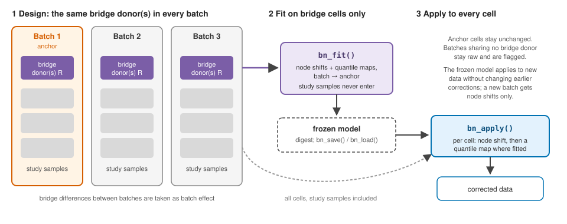

# bridgenorm

Batch correction for cytometry from bridge samples: reference material from the same donor measured in every batch.

Site and articles: <https://mdmanurung.github.io/bridgenorm/>

The differences between bridge samples measure the technical batch effect. bridgenorm estimates the batch effect from them alone: study samples never enter a fit, so a condition that is confounded with batch cannot shape the correction. Each batch is corrected toward one anchor batch, or toward the mean of a chosen set of batches. A fitted model is frozen with a digest, so it applies to new data without changing earlier corrections.



## Methods

`bn_fit()` is the main method. It works on reference cells only, in two passes:

1. A global paired shift places the bridge cells, and a self-organising map (SOM) on the mapping markers splits them into nodes (cell states). Each batch gets a paired shift per node: the mean over shared bridge donors of the batch-minus-anchor donor means.
2. The global shift, map and node shifts are refitted on the pass-1 cells. In each (batch, node), the batch's marker quantiles are mapped onto the anchor's; cells without a map take the pass-2 node shift. This corrects changes in the shape of a distribution, not only its location. Every node's map is shrunk toward the batch-wide map, keeping weight n / (n + `shrink_k`) on its own, so small nodes borrow most. Since 1.1.0 the batch-wide map is read at the node's own values (`shrink_target = "value"`, `shrink_k = 1000`), so a stretch shared by all nodes is kept.


Only batches whose bridge donors equal the anchor's get quantile maps; other bridged batches get node shifts only, and `bn_fit()` warns which. A batch that shares no bridge donor with the anchor is left raw, and `bn_apply()` says so.

These options are off by default.

- `target = "virtual"` corrects every batch, the anchor included, toward a virtual reference. Per SOM node, the reference is the equal-weight mean of the batches' quantile curves. Its benefit over the anchor target was not consistent across benchmarks, so the default stays `target = "anchor"`. It does not combine with `shrink_k = "eb"`.
- `goal_batches`, with `target = "virtual"`, restricts that mean to a chosen set of batches, for example the batches of one study, like CytoNorm's goal distribution. No benchmark benefit is claimed yet.
- `shrink_k = "eb"` estimates one pseudo-count per marker by empirical Bayes, never below 300. It is kept for study; in benchmarks it did not beat the scalar default.
- `shrink_reweight = TRUE` builds each batch-wide map with the target's cell-state mix of bridge cells, for batches whose bridges differ in mix.
- `quantile_maps = FALSE` keeps node shifts only, as an ablation.

`bn_fit_paired()` fits the baseline: one paired shift per population and marker, with no nodes and no quantile maps. Every other model must beat it.

The anchor, SOM grid, mapping markers, seed and transform depend on the data and have no default. The other settings have defaults chosen by benchmarking; check them on your own data.

The article [Compare with CytoNorm and cyCombine on simulated data](https://mdmanurung.github.io/bridgenorm/vignettes/compare.html) runs the three methods on simulated data with known truth.

## Install

```r
remotes::install_github("mdmanurung/bridgenorm")
```

## Use

```r
samples <- data.frame(
  sample_id = ..., batch = ...,
  reference_id = ..., # bridge donor; NA for study samples
  aliquot = ...       # optional
)
bn_bridges(samples, anchor = "b1")

model <- bn_fit(
  x, samples, population = labels, markers = markers,
  transform = list(name = "asinh", cofactor = 6000), anchor = "b1",
  grid = c(6, 6), mapping_markers = mapping, seed = 1
)
res <- bn_apply(model, x, samples, labels)
bn_save(model, "bn_model.rds")
```

The grid and mapping markers above show the shape of a call; choose them for your panel. Worked examples, each on simulated data with known truth:

- [Use case 1: Correct batches with bridge samples](https://mdmanurung.github.io/bridgenorm/vignettes/bridgenorm.html)
- [Use case 2: Normalize toward a goal distribution](https://mdmanurung.github.io/bridgenorm/vignettes/goal-distribution.html)
- [Use case 3: Correct later batches with a frozen model](https://mdmanurung.github.io/bridgenorm/vignettes/frozen-model.html)

## Before you fit

- `x` must already be on the transformed scale (for example asinh with your cofactor). `transform` only records the scale; nothing is transformed for you, and `bn_fit()` warns when the values look untransformed.
- `population` sets the strata of the global pre-shift and of the fallback for cells whose node has no effect. One label for all cells is valid; coarse lineage gates made before correction also work.
- Pick the anchor as the batch with the least noisy bridge samples; `bn_reference_noise()` reports the noise per batch.
- Read `res$actions` after `bn_apply()`: one row per batch, node (or population) and marker, with what was done and why. `table(res$actions$batch, res$actions$reason_code)` is a quick check.
- `bn_apply()` holds a few copies of the data in memory; plan for about 5 GB per million cells, or apply batch by batch.

## Longitudinal studies

- Keep the fitted model. Applying it to later batches does not change earlier corrections. Later batches get node shifts estimated against the frozen anchor, but no quantile maps, so refit on all batches for the final analysis.
- Use one bridge lot. If the bridge material drifts over time, the drift is read as batch effect and its opposite appears as a change over time in every study sample.
- Spread each subject's visits over batches and mix visits within batches where the design allows. Keep a batch term in downstream models; correction lowers but does not remove between-batch noise.

## Limits

- Benchmarked on spectral and conventional flow cytometry. Mass cytometry, with many zero values, is untested.
- Bridge samples should come from one donor, or the same donors in the same cell shares in every batch; quantile maps pool the donors' cells.
- Within a node, a batch effect is assumed to be a monotone change of each marker's distribution. Cells far from every node take the nearest node's correction.

## Origin

bridgenorm was called heb (hierarchical empirical Bayes) up to version 0.7.2. Version 0.9.0 removed the mixed-model fits ported from SpectraWeaveR, because no benchmarked method used them; experiments that need them use heb 0.7.x.
