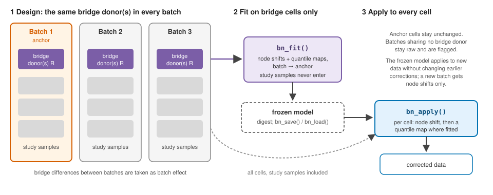
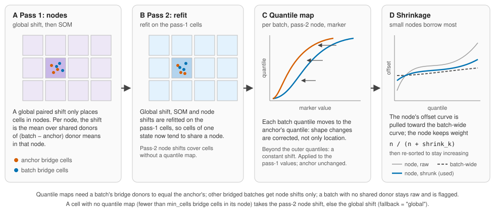

```{r setup, include = FALSE}
knitr::opts_chunk$set(collapse = TRUE, comment = "#>", fig.width = 7, fig.height = 3.2)
```

#### In this vignette, you learn how bridgenorm corrects batch effects from bridge samples, and how to check the result.

In a multi-batch cytometry study, the same reference material (a bridge sample) is measured in every batch. The differences between the bridge samples measure the technical batch effect. bridgenorm estimates the batch effect from the bridge cells alone and corrects every batch toward one anchor batch. Study samples never enter the fit, so a condition that is confounded with batch cannot shape the correction. The fitted model is frozen with a digest, so it can be applied to new data later without changing earlier corrections ([use case 3](frozen-model.html)).

{width=100%}

`bn_fit()` works in two passes. A global paired shift places the bridge cells on a self-organising map (SOM), and a paired shift is estimated per node. The shift, map and node shifts are refitted on the shifted cells. In each batch and node, the batch's marker quantiles are then mapped onto the anchor's, and each node's offset curve is shrunk toward the batch-wide curve, small nodes most.

{width=100%}

The data here are simulated, so every cell's value without the batch effect is known and the correction can be checked against the truth.

## Prepare the bridgenorm normalization step

### Load bridgenorm

```{r library}
library(bridgenorm)
```

### Organize the data

bridgenorm takes one table of cells and one table of samples. The cell table has a `sample_id` column and one column per marker, already transformed (here the values are on an asinh-like scale). The sample table has one row per sample: `sample_id`, `batch`, `reference_id` (the bridge donor, `NA` for study samples) and optionally `aliquot` (the bridge well).

Three batches each hold two bridge wells of one reference donor and two study samples. Cells fall in two cell states, A and B, separated on the marker Lin. Marker M carries the batch effect: in batch b2 it is shifted and compressed, in batch b3 shifted and stretched, and batch b1 is the anchor without an effect. The effect differs between the two cell states, so one shift per batch cannot remove it.

```{r simulate}
set.seed(1)
centre <- c(A = 2, B = 1)
lin <- c(A = 1, B = 4)
effect <- list(
  b1 = list(shift = c(A = 0, B = 0), scale = 1),
  b2 = list(shift = c(A = 0.4, B = -0.3), scale = 0.6),
  b3 = list(shift = c(A = -0.2, B = 0.3), scale = 1.4)
)
samples <- data.frame(
  sample_id = c(outer(c("ref1", "ref2", "s1", "s2"), c("b1", "b2", "b3"), paste, sep = "_")),
  batch = rep(c("b1", "b2", "b3"), each = 4),
  reference_id = rep(c("donor", "donor", NA, NA), 3),
  aliquot = rep(c("ref1", "ref2", NA, NA), 3)
)
cells <- do.call(rbind, lapply(seq_len(nrow(samples)), function(i) {
  b <- samples$batch[i]
  do.call(rbind, lapply(c("A", "B"), function(k) {
    truth <- rnorm(300, centre[[k]], 0.3)
    data.frame(
      sample_id = samples$sample_id[i],
      state = k,
      Lin = rnorm(300, lin[[k]], 0.2),
      M = centre[[k]] + effect[[b]]$scale * (truth - centre[[k]]) + effect[[b]]$shift[[k]],
      truth = truth
    )
  }))
}))
cells$batch <- samples$batch[match(cells$sample_id, samples$sample_id)]
head(cells)
```

### Check the bridges and choose the anchor

Every batch must share a bridge donor with the anchor. `bn_bridges()` checks this; `bn_reference_noise()` reports how noisy each batch's bridge wells are, to help choose the anchor (the least noisy batch is a good choice).

```{r bridges}
bn_bridges(samples, anchor = "b1")
bn_reference_noise(cells[, c("sample_id", "M")], samples, rep("T", nrow(cells)), markers = "M")
```

## Train the bridgenorm model

The model is fitted on bridge cells only. The anchor, the SOM grid, the mapping markers, the seed and the transform depend on the data and must be given. The other settings have benchmarked defaults; here the SOM training is shortened for the toy data. `mapping_markers` define the cell states; every marker in `markers` is corrected, whether or not it is used for mapping.

```{r fit}
model <- bn_fit(
  x = cells[, c("sample_id", "Lin", "M")],
  samples = samples,
  population = rep("T", nrow(cells)),
  markers = c("Lin", "M"),
  transform = list(name = "asinh", cofactor = 5),
  anchor = "b1",
  grid = c(2, 1),
  mapping_markers = "Lin",
  seed = 1,
  train_cells = 300, # this toy data has 600 cells per sample
  rlen = 50
)
model
```

`population` sets the strata of the global pre-shift and of the fallback for cells whose node has no effect. One label for all cells, as here, is valid.

## Apply the bridgenorm model

`bn_apply()` applies the frozen model to all cells, study samples included.

```{r integrate}
res <- bn_apply(model, cells[, c("sample_id", "Lin", "M")], samples, rep("T", nrow(cells)))
```

`res$x` holds the corrected data in the input's shape and row order. `res$actions` says what was done for every pass, batch, node and marker, and why. Rows reading `abstain` kept raw values; `bn_apply()` also sends a message when a whole batch was left raw. Check it before using the result.

```{r check-actions}
table(res$actions$batch, res$actions$reason_code)
```

## Evaluate the quality

### Density plots

The density of M in study cells per batch, before and after correction. After correction, batch b3 lies on the anchor b1. Batch b2 moves to the anchor's peaks, but its peaks stay narrower than b1's: with `shrink_k = 300`, each node's quantile curve is pulled part of the way toward the batch-wide curve, so the compression in b2 is only partly undone. A smaller `shrink_k` trusts each node's own curve more.

```{r density}
study <- is.na(samples$reference_id[match(cells$sample_id, samples$sample_id)])
colours <- c(b1 = "black", b2 = "#E69F00", b3 = "#0072B2")
op <- par(mfrow = c(1, 2), mar = c(4, 4, 2, 1))
for (panel in c("uncorrected", "corrected")) {
  value <- if (panel == "uncorrected") cells$M else res$x$M
  plot(NULL, xlim = c(-0.5, 3.5), ylim = c(0, 1.6), xlab = "M", ylab = "Density", main = panel)
  for (b in names(colours)) {
    lines(density(value[study & cells$batch == b]), col = colours[[b]], lwd = 1.5)
  }
  legend("topright", legend = names(colours), col = colours, lwd = 1.5, bty = "n")
}
par(op)
```

### Quantile-map plots

The quantile maps are the second step of the correction. For each second-pass node, a batch's quantiles of M after the pass-1 shift (x axis) are mapped onto the anchor's (y axis). A map on the diagonal changes nothing; a map steeper than the diagonal stretches, as for the compressed batch b2, and a flatter one compresses, as for the stretched batch b3. The anchor's own map is the diagonal.

```{r quantile-maps}
key_batch <- sub("\r.*", "", names(model$quantiles))
key_node <- sub(".*\r", "", names(model$quantiles))
op <- par(mfrow = c(1, length(unique(key_node))), mar = c(4, 4, 2, 1))
for (node in unique(key_node)) {
  anchor_q <- model$quantiles[[which(key_batch == "b1" & key_node == node)]][, "M"]
  node_q <- unlist(lapply(model$quantiles[key_node == node], function(q) q[, "M"]))
  plot(NULL, xlim = range(node_q), ylim = range(anchor_q),
    xlab = "Batch quantiles of M", ylab = "Anchor quantiles of M", main = node)
  abline(0, 1, col = "grey70", lty = 2)
  for (b in names(colours)) {
    i <- which(key_batch == b & key_node == node)
    if (length(i) == 1) lines(model$quantiles[[i]][, "M"], anchor_q, col = colours[[b]], lwd = 1.5, type = "b", pch = 20)
  }
}
legend("topleft", legend = names(colours), col = colours, lwd = 1.5, bty = "n")
par(op)
```

### Error against the truth

In real data the truth is unknown, and the held-out bridge wells take its place (see the [comparison article](compare.html)). Here each study cell's value without the batch effect is known.

```{r error}
error <- data.frame(
  batch = cells$batch[study],
  uncorrected = abs(cells$M[study] - cells$truth[study]),
  corrected = abs(res$x$M[study] - cells$truth[study])
)
aggregate(cbind(uncorrected, corrected) ~ batch, data = error, FUN = mean)
```

### Earth mover's distance between batches

The earth mover's distance (EMD) between two batches' distributions of a marker is 0 when they match. For the study cells of each batch against the anchor:

```{r emd}
emd <- function(a, b) mean(abs(quantile(a, ppoints(200)) - quantile(b, ppoints(200))))
sapply(c(b2 = "b2", b3 = "b3"), function(b) {
  c(
    uncorrected = emd(cells$M[study & cells$batch == b], cells$M[study & cells$batch == "b1"]),
    corrected = emd(res$x$M[study & cells$batch == b], res$x$M[study & cells$batch == "b1"])
  )
})
```

## Save the model

`bn_save()` stores the model with its digest; `bn_load()` refuses a file whose contents changed after saving.

```{r save}
path <- tempfile(fileext = ".rds")
bn_save(model, path)
identical(bn_load(path), model)
```

## Next

- [Use case 2: Normalize toward a goal distribution](goal-distribution.html): correct every batch toward the mean of a set of batches, for example one study, instead of one anchor batch.
- [Use case 3: Correct later batches with a frozen model](frozen-model.html): longitudinal studies where batches arrive over time.
- `shrink_k = "eb"` replaces the single pseudo-count with one per marker, estimated by empirical Bayes, never below 300. It is kept for study; in benchmarks it did not beat the scalar default.
